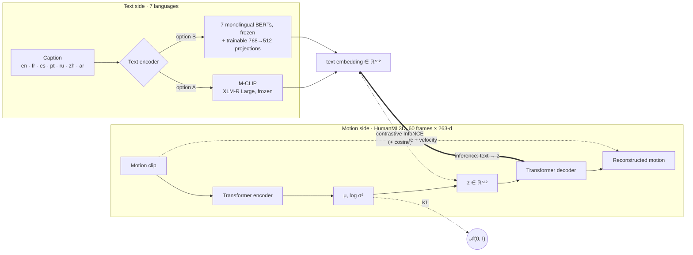
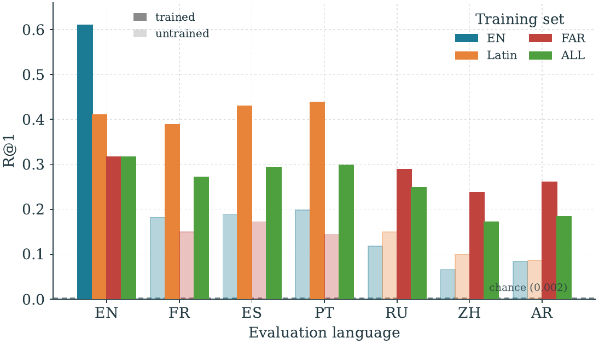
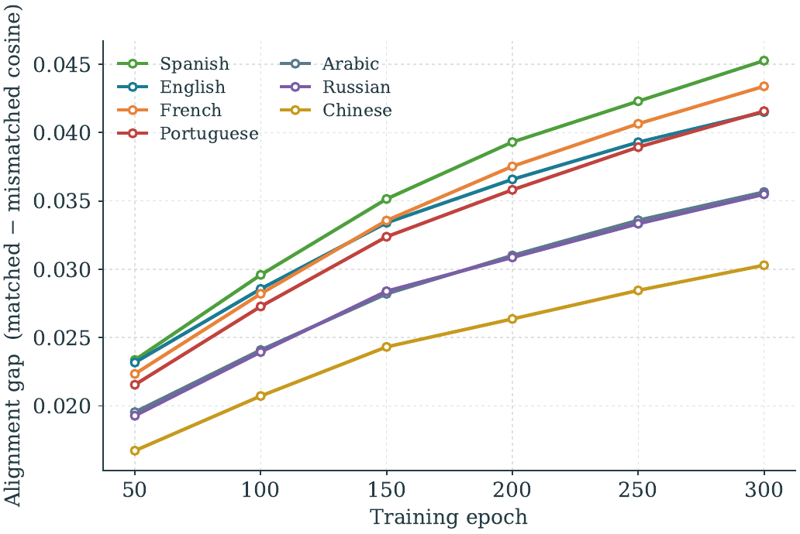
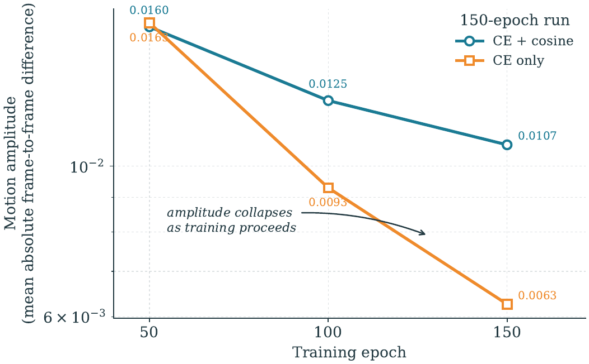

<div align="center">

# Multilingual MotionCLIP

### Text → 3D human motion, in seven languages

*A controlled study of what happens when a motion-generation model stops speaking only English.*

[](#getting-started)
[](#getting-started)
[](#method)
[](https://github.com/EricGuo5513/HumanML3D)
[](#the-question)
[](LICENSE)

**Mohammed Amine Hssaine** · Research internship, **AI Movement – UM6P** · 2025–2026

[📄 Report (EN)](report/report_en.pdf) · [📄 Rapport (FR)](report/report_fr.pdf) · [🧪 Experiment log](docs/EXPERIMENTS.md) · [🛠️ Engineering notes](docs/NOTES.md)

<br>


<sub><i>"a person walks forward", generated from parallel captions in English, French, Spanish, Portuguese, Russian, Chinese and Arabic. Each panel shows its drift from the English motion.</i></sub>

</div>

---

## TL;DR

- Extended **[MotionCLIP](https://github.com/GuyTevet/MotionCLIP)** from English-only CLIP to **7 languages**, using two text-encoder designs: multilingual **M-CLIP**, and a **bank of 7 monolingual BERTs** with learned projections.
- Built the multilingual data myself: **24,844 HumanML3D clips** captioned in 6 new languages with **NLLB-200**, run locally.
- Re-enabled the **variational objective** (which MotionCLIP inherits from ACTOR but disables) and replaced cosine alignment with **contrastive InfoNCE**.
- Wrote the full **evaluation stack**: FID / R-precision / diversity with Guo et al.'s evaluator (MoMask protocol), a **cross-lingual latent-alignment benchmark**, noise-robustness tests, and SMPL mesh rendering.
- **~40 documented training runs** on one RTX 5090, ending in a controlled experiment that answers the research question.

> **Main result.** Adding languages does not enrich a single-latent motion model. It **divides a fixed representational budget**: every language added to training closes its own alignment gap, and English retrieval **halves** (R@1 0.61 → 0.32).

## Contents

[The question](#the-question) · [Method](#method) · [Results](#results) · [Findings](#five-findings) · [Lessons](#engineering-lessons) · [Getting started](#getting-started) · [Repository layout](#repository-layout) · [Next steps](#what-i-would-do-next) · [Citation](#citation)

---

## The question

Almost every text-to-motion model is trained on English captions. My supervisors asked a concrete question:

> *If the text encoder is multilingual, do the projections actually bring the languages together in the shared motion space, or does English dominate while the other languages ride along?*

Answering it means measuring **alignment per language** and **generation quality** separately, under conditions that differ in one variable only.

## Method



| Component | What I did | Where |
|---|---|---|
| **Multilingual data** | Translated 16,383 unique captions (24,844 clips) into fr / es / pt / ru / zh / ar with NLLB-200, resumable and fully local. Dataset class samples **one language per clip per access**, so epoch length matches the English baseline exactly. | [`data/translate_nllb.py`](data/translate_nllb.py), [`src/datasets/humanml3d_ml.py`](src/datasets/humanml3d_ml.py) |
| **Text encoders** | M-CLIP drop-in for CLIP. Per-language bank: CamemBERT, BETO, BERTimbau, RuBERT, Chinese BERT and AraBERT, batched by language, with backbones that can sit on CPU. | [`patches/patch_mclip.py`](patches/patch_mclip.py), [`src/utils/per_lang_encoder.py`](src/utils/per_lang_encoder.py) |
| **Variational objective** | Restored μ/logvar, reparameterisation and KL. Added KL annealing. | [`patches/patch_vae.py`](patches/patch_vae.py), [`patches/patch_anneal.py`](patches/patch_anneal.py) |
| **Alignment loss** | Cosine → contrastive cross-entropy (InfoNCE over the batch), plus a combined CE + cosine variant. | [`training/`](training/) |
| **Evaluation** | Guo et al. evaluator following MoMask exactly (with re-normalisation, 196-frame padding and GloVe tokens), plus a 7-language matched-vs-mismatched alignment and retrieval benchmark. | [`evaluation/`](evaluation/) |

Every change to upstream is a **reversible patch script** (`--revert`), so the original codebase stays clean and each modification can be reviewed on its own.

## Results

### Controlled language comparison

Same architecture, contrastive loss, λ_KL = 1e-3 and 150 epochs. **Only the training language set changes.** Alignment is measured on 500 clips with parallel captions.

| Training languages | EN − non-EN gap ↓ | Cross-lingual spread ↓ | R@1 en | R@1 ar | FID ↓ |
|---|:---:|:---:|:---:|:---:|:---:|
| English only | +0.0318 | 0.0398 | **0.610** | 0.084 | 67.7 |
| Latin · en fr es pt | +0.0087 | 0.0253 | 0.410 | 0.086 | 96.0 |
| Distant · en ru zh ar | +0.0059 | 0.0096 | 0.316 | **0.260** | **63.9** |
| All 7 | **+0.0019** | **0.0071** | 0.316 | 0.184 | 74.0 |

<p align="center">
  
  <br><sub><i>Retrieval R@1 for each evaluation language. Solid bars are languages that were in the training set; pale bars are languages the model never trained on. Chance is 0.002.</i></sub>
</p>

Each language family helps **its own** languages (Latin lifts fr / es / pt to about 0.4; Distant lifts ru / zh / ar to about 0.25), and **English pays for it**. That is the signature of a shared, fixed-capacity bottleneck.

### Alignment keeps improving, with a stable language hierarchy

<table>
<tr>
<td width="50%"></td>
<td width="50%"></td>
</tr>
<tr>
<td><sub><b>Left:</b> the contrastive alignment gap rises in every language with no plateau at 300 epochs. The ordering es ≈ en > fr > pt > ar ≈ ru > zh is identical at every checkpoint.</sub></td>
<td><sub><b>Right:</b> meanwhile, generated motion amplitude <i>decays</i>. The combined CE + cosine loss slows the collapse.</sub></td>
</tr>
</table>

### Samples

| Running | Jumping | Kicking | Sitting down |
|:---:|:---:|:---:|:---:|
|  |  |  |  |

Seven-language comparisons for *jump, run, kick* and *sit* are in [`assets/gifs/languages/`](assets/gifs/languages/).

## Five findings

| # | Finding | Evidence |
|:-:|---|---|
| 1 | In a single-latent motion VAE, **sampling, not KL weight, collapses reconstruction.** | A 100× change in λ_KL moved reconstruction error by 0.002 (0.524 → 0.526), against 0.083 for the deterministic model. Annealing did not help. |
| 2 | **The cosine objective learns no per-sample alignment** at any weight. Contrastive CE does, in all 7 languages. | Matched − mismatched gap: 0.0002 with cosine, 0.0007 with cosine ×100, **0.0206** with CE. A loss with no negatives has a constant solution as its optimum. |
| 3 | **Alignment and generation quality dissociate.** | The alignment gap keeps rising through 300 epochs, while generation diversity stays at 0.92 against 9.68 for real motion. |
| 4 | **Motion amplitude decays monotonically** under MSE reconstruction. | 0.0163 → 0.0093 → 0.0063 at epochs 50 / 100 / 150. I ruled out rendering, text-embedding scale and velocity weight as causes. |
| 5 | **Languages share a fixed budget** rather than enriching it. | Controlled comparison above. |

The common cause behind 1, 4 and 5 is architectural: **one 512-d vector has to carry 60 frames of motion in any of 7 languages.** The proposed fix is a *sequence* of discrete latents (MoMask-style, with M-CLIP conditioning), argued in chapter 5 of the [report](report/report_en.pdf).

## Engineering lessons

The project produced as much debugging as modelling. These are the traps that silently produce wrong numbers; the full list is in [`docs/NOTES.md`](docs/NOTES.md).

- **Training losses are not evidence.** CE loss sat at chance (`ln(batch)`) while alignment improved 100×, and reconstruction loss looked healthy while generated motion collapsed to a near-static pose. Everything here is checked against an evaluation metric.
- **`reparameterize()` coupled λ_KL to sampling upstream.** Every "annealing" run therefore trained with full noise from epoch 1. Finding this reframed the whole KL series.
- **A text-encoder mismatch fails silently.** Generating from an M-CLIP checkpoint with CLIP embeddings gives plausible-looking, meaningless motion with no error raised, so `--text_encoder` is now explicit everywhere.
- **The evaluator has its own normalisation.** Motion must be de-normalised with dataset statistics and re-normalised with the evaluator's, or FID is meaningless.
- **MotionCLIP is deterministic,** so MoMask's 20-repeat confidence interval measures retrieval grouping, not model variance. The evaluation script documents this deviation instead of hiding it.

## Getting started

This project extends the original MotionCLIP codebase rather than forking it. Install the tools into an upstream checkout:

```bash
# 1. upstream code and data (follow their READMEs for HumanML3D and SMPL)
git clone https://github.com/GuyTevet/MotionCLIP.git
git clone https://github.com/EricGuo5513/HumanML3D.git ~/HumanML3D

# 2. dependencies
pip install -r requirements.txt

# 3. copy scripts, captions and modules into the checkout
bash install.sh /path/to/MotionCLIP

# 4. apply the patches (each one supports --revert)
cd /path/to/MotionCLIP
python patch_mclip.py && python patch_ml.py && python patch_vae.py
python patch_perlang.py   # optional: per-language BERT bank
```

**Train** a seven-language contrastive model:

```bash
python -m src.train.train --folder ./exps/ce150-all \
  --dataset humanml3d_ml --datapath ./data/HumanML3D --langs en fr es pt ru zh ar \
  --text_encoder mclip --clip_text_losses ce --clip_image_losses '' --clip_lambda_ce 10 \
  --modelname motionclip_transformer_rc_rcxyz_vel --latent_dim 512 --num_layers 8 \
  --batch_size 128 --num_epochs 150 --lambda_kl 1e-3 --pose_rep xyz --num_frames 60
```

**Evaluate and generate:**

```bash
# cross-lingual alignment: matched vs mismatched cosine and retrieval, 7 languages
python eval_latent_alignment.py --ckpt exps/ce150-all/checkpoint_0150.pth.tar \
    --tag ce150-all --n 500 --text_encoder mclip

# FID / R-precision / diversity with Guo et al.'s evaluator
python eval_guo_vae_compare_beta05.py --model original --replications 20 \
    --ckpt exps/ce150-all/checkpoint_0150.pth.tar

# text -> motion GIFs, in any of the seven languages
python gen_hml.py "a person walks forward" "une personne saute" "一个人在跑步" \
    --ckpt exps/ce150-all/checkpoint_0150.pth.tar --text_encoder mclip --frames 60

# reproduce every controlled-comparison number
bash eval_all.sh
```

## Repository layout

```
├── src/
│   ├── datasets/humanml3d_ml.py   multilingual HumanML3D, one language sampled per clip
│   └── utils/per_lang_encoder.py  7 frozen BERTs with trainable projections
├── patches/          reversible in-place patches to upstream MotionCLIP
├── data/             NLLB-200 translation pipeline and captions in 7 languages
├── training/         the exact training queues behind every experiment
├── evaluation/       FID / R-precision (MoMask protocol), latent alignment, noise robustness
├── visualization/    generation, GIF rendering, SMPL mesh fitting, training curves
├── results/          raw alignment JSONs, evaluation logs, training-curve figures
├── assets/           README figures and generated motion GIFs
├── docs/             EXPERIMENTS.md (every run, with headline numbers) and NOTES.md (bugs, traps)
└── report/           full report in English and French (LaTeX source and PDF)
```

## What I would do next

1. **Sequence of latents.** Replace the single `muQuery` token with N tokens, so noise on one latent only damages its own frame span.
2. **Velocity supervision on the text-conditioned path.** `text_rc` raises text conditioning 6–7×, but it is pure positional MSE.
3. **Sweep λ_KL**, which was only compared against zero.
4. **Human-written non-English captions**, to separate translation artefacts from real linguistic variation.

## Citation

```bibtex
@techreport{hssaine2026multilingualmotionclip,
  title       = {Multilingual Text-to-Motion Generation: A Controlled Study of MotionCLIP in Seven Languages},
  author      = {Hssaine, Mohammed Amine},
  institution = {AI Movement, Mohammed VI Polytechnic University (UM6P) and ENSAM Meknès},
  year        = {2026},
  url         = {https://github.com/medaminehssaine/multilingual-motionclip}
}
```

## Acknowledgements

Supervised by **Naima Outberdout, Ph.D.** and **Ismail Chihab** at **AI Movement**, the International Center for Artificial Intelligence of Morocco (UM6P).
Built on [MotionCLIP](https://github.com/GuyTevet/MotionCLIP) (Tevet et al., 2022), [HumanML3D](https://github.com/EricGuo5513/HumanML3D) (Guo et al., 2022), [M-CLIP](https://github.com/FreddeFrallan/Multilingual-CLIP), [NLLB-200](https://github.com/facebookresearch/fairseq/tree/nllb) and the [MoMask](https://github.com/EricGuo5513/momask-codes) evaluation code. The translated captions are derived from HumanML3D and follow its license.

<div align="center">
<br>

**Mohammed Amine Hssaine** · AI & Data Technologies, ENSAM Meknès

[](https://www.linkedin.com/in/medaminehssaine/)
[](https://medaminehssaine.vercel.app)
[](https://github.com/medaminehssaine)

</div>
