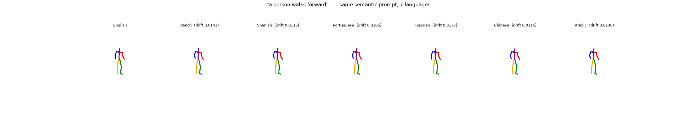
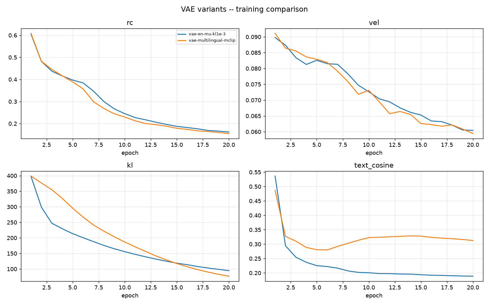
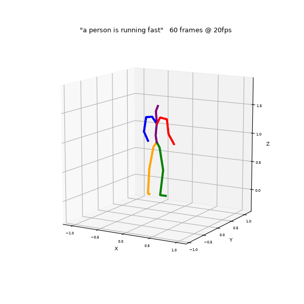
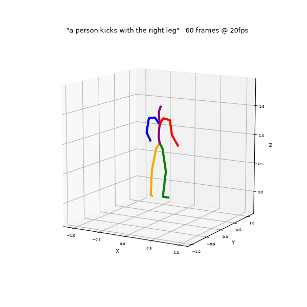
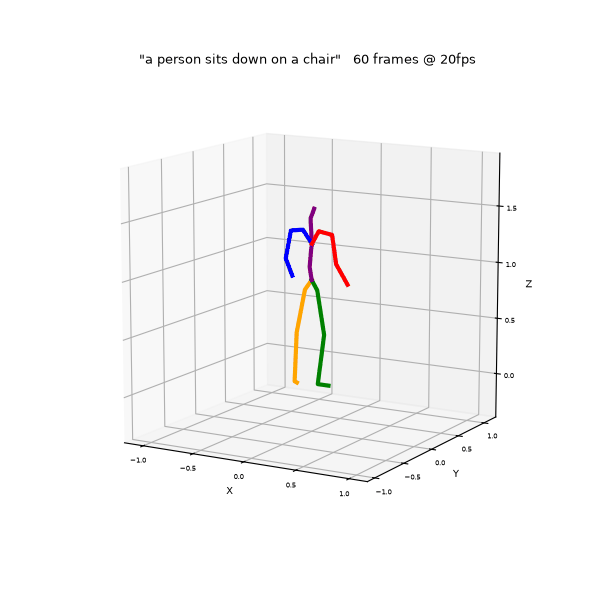

# Multilingual MotionCLIP

**Text-to-3D-human-motion in seven languages:** a controlled study of extending
[MotionCLIP](https://github.com/GuyTevet/MotionCLIP) from English-only CLIP to
multilingual text encoders.

Internship project at **AI Movement – UM6P** (International Center for Artificial
Intelligence of Morocco), 2025–2026 · ENSAM Meknès, AI & Data Technologies.

<p align="center">
  <br>
  <em>"a person walks forward" generated from the same caption in English, French, Spanish,
  Portuguese, Russian, Chinese and Arabic, with drift measured against the English motion.</em>
</p>

---

## Overview

Text-to-motion models are trained almost entirely on English captions. This project
asks what happens when you condition a motion model on **seven languages**
(en, fr, es, pt, ru, zh, ar), and whether adding languages helps or just spreads a
fixed capacity more thinly.

Starting from MotionCLIP (a transformer autoencoder that compresses a 60-frame motion
into one 512-d latent aligned with CLIP), I:

- **translated HumanML3D** (24,844 clips) into 6 languages with NLLB-200, running locally;
- **swapped the text tower**: frozen CLIP → multilingual **M-CLIP**, plus an alternative
  **bank of per-language BERT encoders** with learned projections;
- **restored the variational objective** (μ/logvar, reparameterisation, KL, annealing) that
  MotionCLIP inherits from ACTOR but switches off;
- replaced the cosine alignment loss with a **contrastive (InfoNCE) objective**;
- built the **evaluation tooling**: Guo et al. / MoMask FID and R-precision, a cross-lingual
  latent-alignment benchmark, noise-robustness tests, and visualisation (skeletons, SMPL meshes);
- ran **~40 training runs** on a single RTX 5090 and documented every one in [`docs/EXPERIMENTS.md`](docs/EXPERIMENTS.md).

## Key findings

| # | Finding | Evidence |
|---|---|---|
| 1 | In a single-latent motion VAE, **sampling, not KL weight**, collapses reconstruction. | 100× change in λ_KL moved reconstruction error by 0.002 (0.524 → 0.526) vs 0.083 deterministic |
| 2 | The **cosine objective learns no per-sample alignment** at any weight; contrastive CE does, in all 7 languages. | matched − mismatched gap: 0.0002 (cosine) → 0.0206 (CE) |
| 3 | **Alignment and generation quality dissociate.** | alignment gap keeps rising through 300 epochs, while generation diversity stays at 0.92 vs 9.68 for real motion |
| 4 | Generated **motion amplitude decays monotonically** under MSE reconstruction. | 0.0163 → 0.0093 → 0.0063 at epochs 50 / 100 / 150 (`ce150-all`) |
| 5 | **Languages share a fixed budget rather than enrich it.** | below |

### Controlled language comparison

Same architecture, loss, and 150 epochs. Only the training language set changes.

| Training languages | EN − non-EN gap ↓ | Cross-lingual spread ↓ | Retrieval R@1 (en / ar) | FID ↓ |
|---|---|---|---|---|
| English only | +0.0318 | 0.0398 | **0.610** / 0.084 | 67.7 |
| Latin (en fr es pt) | +0.0087 | 0.0253 | 0.410 / 0.086 | 96.0 |
| Distant (en ru zh ar) | +0.0059 | 0.0096 | 0.316 / **0.260** | **63.9** |
| All 7 | **+0.0019** | **0.0071** | 0.316 / 0.184 | 74.0 |

Each added language closes its own gap, but English retrieval halves. The proposed fix is
architectural: replace the single latent with a **sequence of discrete latents**
(MoMask-style, with M-CLIP conditioning). See the [report](report/) for the full argument.

<p align="center">
  
</p>

## Repository layout

```
patches/         in-place patches to a MotionCLIP checkout (each supports --revert)
  patch_mclip.py     CLIP → M-CLIP text encoder
  patch_ml.py        multilingual HumanML3D dataset + --langs flag
  patch_perlang.py   per-language frozen BERT bank with trainable projections
  patch_vae.py       re-enable μ/logvar, reparameterisation, KL loss
  patch_anneal.py    KL annealing schedule
data/            NLLB-200 caption translation + captions in 7 languages
training/        the exact training queues used for the experiments
evaluation/      FID / R-precision (Guo, MoMask protocol), latent alignment, noise tests
visualization/   text→motion generation, GIF rendering, SMPL mesh fitting, training curves
results/         raw alignment JSONs, evaluation logs, figures
docs/            EXPERIMENTS.md (every run + headline number), NOTES.md (bugs, traps, open threads)
report/          internship report (FR + EN, LaTeX source + PDF) and defense slides
```

## Getting started

This repo extends the original MotionCLIP codebase rather than forking it.

```bash
# 1. upstream code + HumanML3D (follow their READMEs for data and SMPL files)
git clone https://github.com/GuyTevet/MotionCLIP.git
git clone https://github.com/EricGuo5513/HumanML3D.git ~/HumanML3D

# 2. dependencies
pip install -r requirements.txt

# 3. copy this project's tools into the checkout
bash install.sh /path/to/MotionCLIP

# 4. apply the patches you need, from inside the checkout
cd /path/to/MotionCLIP
python patch_mclip.py && python patch_ml.py && python patch_vae.py
```

> `patch_ml.py` registers `src/datasets/humanml3d_ml.py` and `patch_perlang.py` imports
> `src/utils/per_lang_encoder.py`. Those two modules lived in the training checkout and
> are not part of this repository yet.

Train a multilingual contrastive model:

```bash
python -m src.train.train --folder ./exps/ce150-all \
  --dataset humanml3d_ml --datapath ./data/HumanML3D --langs en fr es pt ru zh ar \
  --text_encoder mclip --clip_text_losses ce --clip_image_losses '' --clip_lambda_ce 10 \
  --modelname motionclip_transformer_rc_rcxyz_vel --latent_dim 512 --num_layers 8 \
  --batch_size 128 --num_epochs 150 --lambda_kl 1e-3 --pose_rep xyz --num_frames 60
```

Evaluate and generate:

```bash
# cross-lingual alignment (matched vs mismatched cosine + retrieval, 7 languages)
python eval_latent_alignment.py --ckpt exps/ce150-all/checkpoint_0150.pth.tar \
    --tag ce150-all --n 500 --text_encoder mclip

# FID / R-precision / diversity with Guo et al.'s evaluator
python eval_guo_vae_compare_beta05.py --model original --replications 20 \
    --ckpt exps/ce150-all/checkpoint_0150.pth.tar

# text → motion GIFs
python gen_hml.py "a person walks forward" "une personne saute" "人在跑步" \
    --ckpt exps/ce150-all/checkpoint_0150.pth.tar --text_encoder mclip --frames 60
```

`docs/NOTES.md` lists the bugs found in the upstream code and the traps that silently
ruin results (for example, a `--text_encoder` mismatch produces plausible-looking but
meaningless motion).

## More samples

| Running | Jumping | Kicking | Sitting |
|---|---|---|---|
|  |  |  |  |

Cross-lingual comparisons for *jump, run, kick, sit* are in
[`assets/gifs/languages/`](assets/gifs/languages/).

## Report

- 📄 [Full report (French)](report/report_fr.pdf) · [English version](report/report_en.pdf)
- 🎤 [Defense slides](report/defense_slides_fr.pdf)
- LaTeX sources in `report/fr` and `report/en`. `make_figures.py` rebuilds the data figures
  from `results/alignment/`.

## Acknowledgements

Supervised by **Naima Outberdout, Ph.D.** and **Ismail Chihab** at AI Movement, UM6P.
Built on [MotionCLIP](https://github.com/GuyTevet/MotionCLIP) (Tevet et al., 2022),
[HumanML3D](https://github.com/EricGuo5513/HumanML3D) (Guo et al., 2022),
[M-CLIP](https://github.com/FreddeFrallan/Multilingual-CLIP),
[NLLB-200](https://github.com/facebookresearch/fairseq/tree/nllb) and the
[MoMask](https://github.com/EricGuo5513/momask-codes) evaluation code.
Translated captions are derived from HumanML3D and follow its license.

## Author

**Mohammed Amine Hssaine**, AI & Data Technologies engineering student, ENSAM Meknès.
